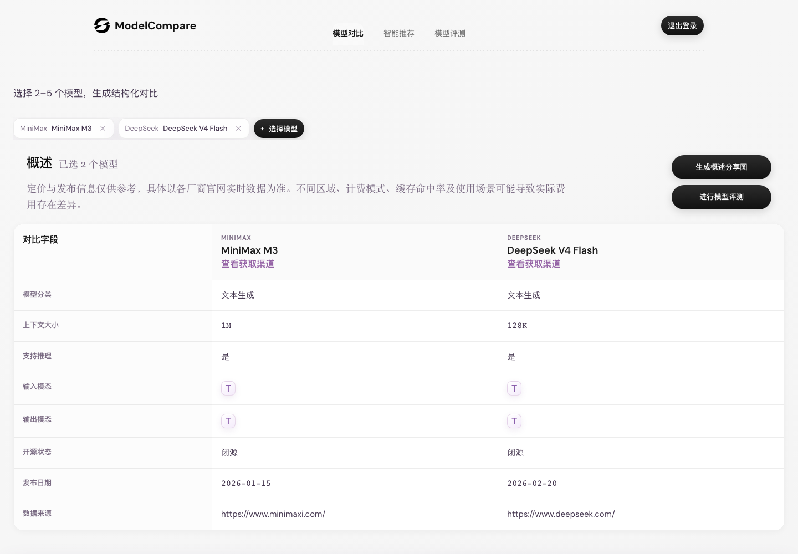
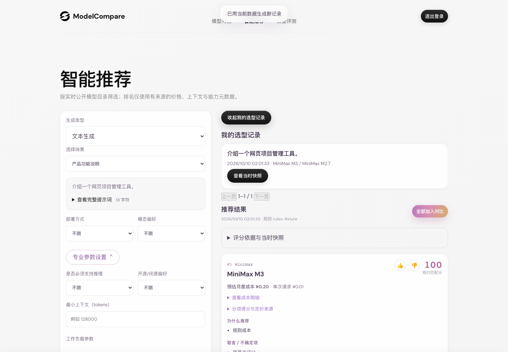
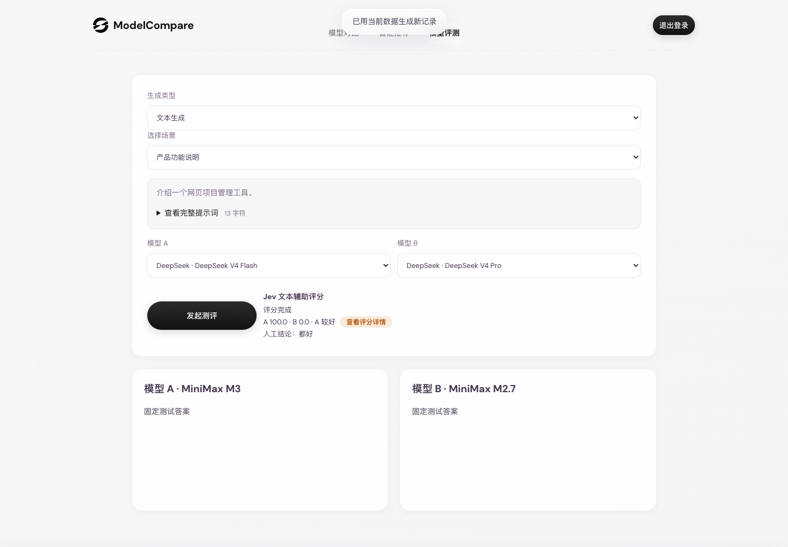
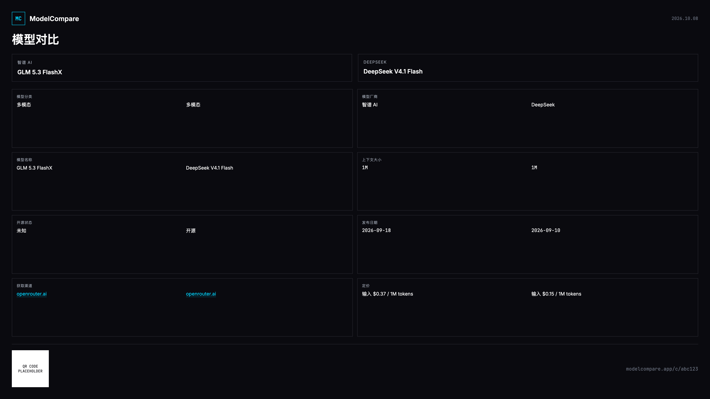
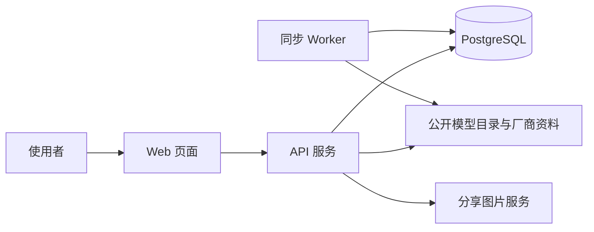

# ModelCompare

> 一个面向实际业务场景的 AI 模型选型、对比与评测平台。

ModelCompare 帮助团队把“应该选哪个模型”的讨论，变成可比较、可解释、可回看的决策过程。你可以浏览模型信息、按预算和能力约束获得推荐、在同一任务下并排评测模型，并保存结果供后续复盘。

> 页面截图只使用公开模型资料和演示数据

## 平台页面

### 模型数据对比

选择 2–5 个模型后，以结构化表格横向查看模型分类、上下文、推理能力、输入/输出模态、开源状态、发布日期和公开资料来源。页面会明确提示定价和发布日期需要以厂商实时信息为准。



### 智能推荐

根据生成类型、任务场景、部署偏好、上下文长度、预算和模型能力等条件筛选候选模型；结果会展示匹配分、成本估算、推荐原因与数据来源提示，便于理解“为什么是它”。



### 模型评测

为同一文本或图片场景选择两款模型，集中查看生成结果，并支持记录人工结论。适合在真正接入业务前，用统一场景做横向判断。



### 模型对比与分享

将核心模型信息整理为便于沟通的对比卡片，包括厂商、上下文、开源状态、发布日期与价格等字段；字段以采集来源为准，缺失信息会如实保留。



## 能做什么

- **模型目录与横向对比**：集中查看模型厂商、能力、上下文、定价与来源信息。
- **按条件推荐模型**：使用明确的硬约束和排序规则缩小候选范围，避免只凭印象选型。
- **文本与图片评测**：在统一任务下对比两款模型的输出，保留评测记录与人工判断。
- **选型记录回看**：保存推荐快照，方便复盘当时的条件与结果。
- **安全的权限边界**：普通用户只能访问自己的推荐和评测记录；管理功能使用独立管理员邀请码。
- **可分享的对比卡片**：将公开模型信息整理成图片，便于在团队中讨论。

## 工作方式



| 部分 | 作用 |
| --- | --- |
| `web/` | Next.js 页面外壳，提供 `/modelcompare` 入口。 |
| `prototype/` | 当前主要的页面、样式与浏览器交互代码。 |
| `server/api.js` | 登录、模型查询、推荐、评测与管理 API。 |
| `server/` + Prisma | PostgreSQL 数据模型、目录同步与后台任务。 |
| `server/share.js` | 生成模型对比分享图片。 |

## 快速开始

### 环境要求

- Node.js 22+
- PostgreSQL 16+
- npm

### 本地启动

1. 以 `server/.env.example` 为模板创建本地 `server/.env`，填写数据库连接、普通邀请码和管理员邀请码。
2. 如需真实生成或模型评测，再按需填写对应厂商的 API 配置；未配置的功能会保持不可用或降级，不要填写虚构密钥。
3. 启动 API 与前端：

```bash
# 终端 1：API 与数据库准备
cd server
npm install
npm run db:generate
npm run db:push
npm run sync
npm run api
```

```bash
# 终端 2：网页
cd web
npm install
npm run dev
```

本地网页默认请求 `http://localhost:3456` 的 API。

### Docker Compose

1. 在项目根目录创建未提交的 `.env`，仅设置 `POSTGRES_PASSWORD`。
2. 按上文准备未提交的 `server/.env`。
3. 启动服务：

```bash
docker compose up --build -d
```

生产环境请使用 HTTPS 和反向代理，不要直接暴露开发端口。

## 安全与数据说明

- 不要提交 `.env`、数据库连接串、API 密钥、邀请码、会话令牌或真实用户数据。
- 使用 `server/.env.example` 作为配置模板；它只描述变量名和示例，不应填入真实凭据。
- 推荐与评测记录按当前登录用户隔离；管理员能力仅通过管理员身份进入。
- 模型价格、能力和上下文信息来自公开资料或目录同步，可能变化。重要采购或上线决策请回到厂商官方页面确认。
- 推荐结果用于辅助决策，不替代安全、合规、成本或业务验收。

## 验证

常规修改后可运行：

```bash
cd server
npx prisma validate
npm run test:isolation

cd ../web
npm run build
```

`test:isolation` 使用专门的临时测试邀请码验证用户之间无法越权读取推荐、反馈和评测历史；请在独立测试环境运行，不要在生产环境直接执行。

## 许可

本项目采用 [Apache License 2.0](LICENSE) 开源。
